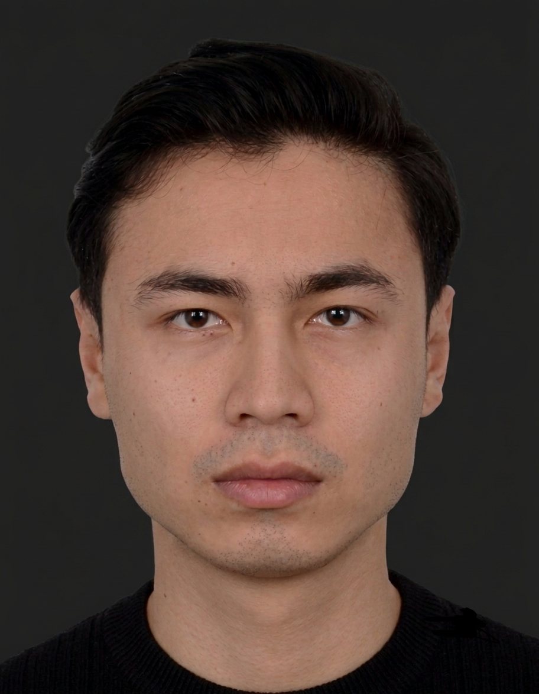

---
hide:
  - toc
  - navigation
---
<!--
CHECKLIST FOR THIS PAGE:
- [ ] Replace [YOUR NAME] with your full name (3 places)
- [ ] Replace [YOUR JOB TITLE] with your current or target role
- [ ] Replace [YOUR TAGLINE] with a short phrase describing your focus
- [ ] Rewrite the About Me paragraph with your own words
- [ ] Replace assets/images/profile.png with your actual photo (keep the filename or update it below)
- [ ] Replace assets/images/about.png with your own image (a field photo, map, or workspace shot)
- [ ] Edit the skill cards to match your actual skills (add, remove, or rename cards as needed)
- [ ] Update GitHub and LinkedIn links in the Connect section
- [ ] Add your CV PDF to docs/assets/ and update the filename in the Download CV button
-->

  
  <h1>Hemungshew Borgohain</h1>
  
<strong>Geoinformatik Master's Student</strong>

  
Universität Salzburg | Geospatial Developer & Data Scientist

  
<em>~Mapping Patterns Decoding Places~</em>

---

## About Me

I am an aspiring Geospatial Professional pursuing an MSc in Applied Geoinformatics at Paris Lodron Universität Salzburg. With expertise in GIS, remote sensing, spatial analysis, and geospatial programming, I work at the intersection of geography and data to transform complex spatial information into meaningful insights. My experience includes satellite and drone data processing, cartographic visualization, spatial database management, and geospatial analytics. As I continue to expand my capabilities in GeoAI, deep learning, and advanced remote sensing, I remain committed to leveraging geospatial technology to address real-world challenges and support informed decision-making.

  

---

[View My Projects :material-arrow-right:](projects/index.md){ .md-button .md-button--primary }
[Download CV :material-download:](assets/Hemungshew-CV.pdf){ .md-button }

---

## Skills

-   :material-layers:{ .lg .middle } **GIS & Remote Sensing**

    ---

    - QGIS, ArcGIS Pro, Online, Google Earth Engine
    - ErdasImagine, AutoCAD Map
    - Multispectral and SAR image analysis
    - Cloud Native Geospatial (COG, STAC, Zarr) [pending]

-   :material-code-braces:{ .lg .middle } **Programming**

    ---

    - Python — GeoPandas, NumPy, Pandas, Matplotlib
    - R — sf, terra, ggplot2
    - JavaScript — Leaflet, MapLibre GL [pending]
    - SQL, PostgreSQL + PostGIS [pending]

-   :material-star-four-points:{ .lg .middle } **Machine Learning & GeoAI**

    ---

    - Supervised classification — Random Forest, XGBoost
    - Deep learning for image segmentation — U-Net, SAM [pending]
    - scikit-learn, PyTorch, TensorFlow [pending]
    - Object detection in satellite imagery 

-   :material-earth:{ .lg .middle } **Web Mapping & Data**

    ---

    - Leaflet.js, Folium, MapLibre GL JS [*]
    - Cloud storage — AWS S3, Google Cloud Storage [*]
    - Data formats — GeoTIFF, GeoParquet, NetCDF
    - Streamlit for data-driven web apps

-   :material-database:{ .lg .middle } **Data & Cloud**

    ---

    - PostgreSQL + PostGIS [*]
    - Cloud storage: AWS S3, Google Cloud Storage [*]
    - Data formats: GeoJSON, GeoTIFF, NetCDF, Zarr, GeoParquet

-   :material-airplane:{ .lg .middle } **Drone / UAV Data Processing**

    ---

    - Mission planning and flight operations
    - Photogrammetry: Agisoft Metashape, OpenDroneMap
    - Point cloud processing: CloudCompare, PDAL

---

## Connect

[GitHub](https://github.com/hemungshewborgohain7777){ .md-button }
[LinkedIn](https://linkedin.com/in/et7777){ .md-button }
